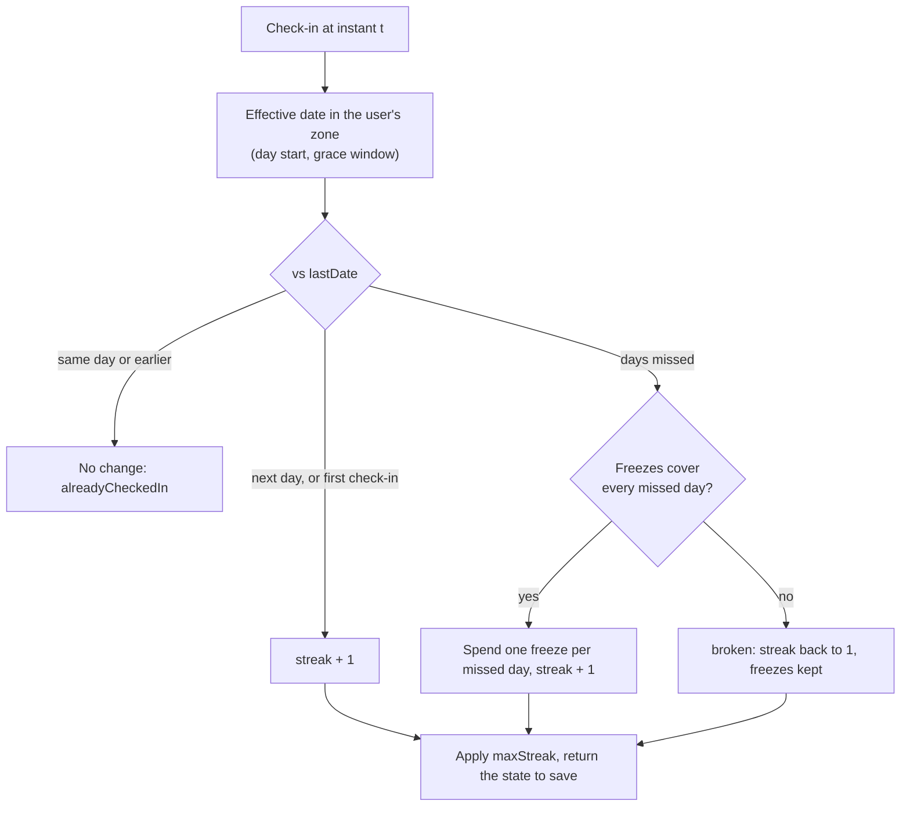

# gamification-kit

**Daily check-ins, streaks, XP levels, quests, leaderboards and caps that stay correct across time zones and daylight saving time. Same behavior in JavaScript and PHP.**

[](https://moonetix.github.io/gamification-kit/)
[](https://github.com/moonetix/gamification-kit/actions/workflows/ci.yml)
[](LICENSE)
[](package.json)
[](package.json)
[](composer.json)
[](https://moonetix.com/academy/monetization/rewards-app-retention)

Maintained by [Moonetix](https://moonetix.com).

Most streak bugs are time zone bugs. A server that adds 86,400 seconds, or takes the date in UTC, breaks a New York user's streak twice a year and starts a Sydney user's "new day" before lunch. This kit does the calendar work in each user's own IANA time zone, with written rules for days that last 23, 23.5, 24.5 or 25 hours and for midnights that never happen. The rest is integer math over state you store yourself, in whatever database you already use. The [live playground](https://moonetix.github.io/gamification-kit/) runs the library in your browser: move the clock, skip days, fly across zones and cross DST changes, and watch the streak stay correct.

- **JavaScript:** ESM, zero dependencies, TypeScript declarations. Time zones through `Intl`.
- **PHP:** 8.1+, zero dependencies. Time zones through `DateTimeZone`.
- **One spec:** both suites run the same [test vectors](test-vectors/vectors.json), including real 2026 transitions in New York, Budapest, Lord Howe Island, Santiago and Beirut.

> [!IMPORTANT]
> **Engagement, not earnings.** These mechanics are for your own product's engagement: XP, levels, badges, streak counters and cosmetic perks. If your users earn a currency through an offerwall, do not reward check-ins, streaks, quests or leaderboard ranks with that currency or with anything else that has money-like value. Rewards tied to offers come only from completed offers.

## Building blocks

| Function | What it does |
| --- | --- |
| `checkIn(state, options)` | Records a daily check-in in the user's zone. Same-day repeats change nothing. Freezes and an optional grace window keep honest streaks alive. |
| `streakStatus(state, options)` | Read-only: is the streak alive, was today counted, and the instant it ends. |
| `streakReward(schedule, day)` | Value for day N of a schedule such as `[10, 10, 20, 20, 30, 30, 50]`. |
| `linearCurve`, `polynomialCurve`, `tableCurve` | XP curves. Integer exponents 1 to 4, or any table you build. |
| `levelForXp(curve, xp)` | Level, XP into the level, XP to the next one, progress in basis points. |
| `xpForLevel(curve, level)` | Total XP a level needs. |
| `defineQuest(definition)`, `questProgress(state, quest, options)` | Missions with a target and daily, weekly, monthly or no reset, in the user's zone. |
| `rankEntries(entries, { tie })` | Leaderboard ranks: shared (1, 1, 3), dense (1, 1, 2), ordinal or earliest-first. |
| `aroundId(ranked, id, radius)` | "You and the players around you." |
| `applyXpCap(state, options)` | A daily ceiling on XP, or on how often an action counts. |
| `cooldown(lastAt, at, seconds)` | Elapsed-time cooldowns. |
| `changeTimeZone(state, options)` | Lets a user change zone at most once per 30 days by default. |
| `localDate`, `startOfLocalDay`, `periodWindow` | The calendar layer the rest is built on. |
| `addDays`, `daysBetween`, `weekday`, `utcOffset` | Calendar helpers on `YYYY-MM-DD` strings. |

Every function is pure. Load the state, call the function, save the state it returns. Instants are integer Unix seconds, dates are `YYYY-MM-DD` strings, and zones are IANA names such as `America/New_York`.



## Install

The package is not on npm or Packagist yet. Copy it in or install from Git:

```bash
npm install github:moonetix/gamification-kit
composer config repositories.gamification-kit vcs https://github.com/moonetix/gamification-kit
composer require moonetix/gamification-kit:^1.0
```

## Quick start

**JavaScript**

```js
import { checkIn, streakStatus, polynomialCurve, levelForXp, defineQuest, questProgress, applyXpCap, rankEntries } from 'gamification-kit';

const timeZone = 'America/New_York'; // the user's zone, saved on their profile
const at = 1794450600; // 2026-11-11 21:30 in New York; in production Math.floor(Date.now() / 1000)

// Daily check-in: load the saved state, check in, save the returned state.
const saved = { lastDate: '2026-11-09', streak: 4, longest: 9, freezes: 1 };
const { state, result } = checkIn(saved, { at, timeZone });
console.log(JSON.stringify({ streak: result.streak, usedFreezes: result.usedFreezes, lastDate: state.lastDate }));
// -> {"streak":5,"usedFreezes":1,"lastDate":"2026-11-11"}

// An hour later: today is done, and the streak lasts until Nov 13 starts in New York.
console.log(JSON.stringify(streakStatus(state, { at: at + 3600, timeZone })));
// -> {"alive":true,"streak":5,"checkedInToday":true,"freezesNeeded":0,"endsAt":1794546000,"cycleDay":5}

// Levels: level L needs 100 x (L - 1)^2 XP.
const curve = polynomialCurve({ base: 100, exponent: 2 });
const level = levelForXp(curve, 950);
console.log(JSON.stringify([level.level, level.xpToNextLevel, level.progressBps]));
// -> [4,650,714]

// A daily quest that resets at local midnight.
const quest = defineQuest({ id: 'win-3-matches', target: 3, reset: 'daily' });
const q = questProgress(null, quest, { amount: 1, at, timeZone });
console.log(JSON.stringify(q.result));
// -> {"progress":1,"target":3,"completed":false,"justCompleted":false,"periodKey":"day:2026-11-11","resetsAt":1794459600}

// At most 500 XP a day: 450 were already granted today.
const cap = applyXpCap({ date: '2026-11-11', granted: 450 }, { amount: 100, at, timeZone, dailyCap: 500 });
console.log(JSON.stringify([cap.granted, cap.capped]));
// -> [50,50]

// A weekly board with shared ranks for ties.
const board = rankEntries(
  [
    { id: 'mia', score: 1200 },
    { id: 'leo', score: 1500 },
    { id: 'ava', score: 1200 },
    { id: 'kai', score: 900 },
  ],
  { tie: 'shared' },
);
console.log(board.map((e) => `${e.rank}. ${e.id}`).join(', '));
// -> 1. leo, 2. ava, 2. mia, 4. kai
```

**PHP**

```php
require 'vendor/autoload.php';

use Moonetix\Gamification\Gamification as G;

$timeZone = 'America/New_York'; // the user's zone, saved on their profile
$at = 1794450600; // 2026-11-11 21:30 in New York; in production time()

// Daily check-in: load the saved state, check in, save the returned state.
$saved = ['lastDate' => '2026-11-09', 'streak' => 4, 'longest' => 9, 'freezes' => 1];
['state' => $state, 'result' => $result] = G::checkIn($saved, ['at' => $at, 'timeZone' => $timeZone]);
echo json_encode(['streak' => $result['streak'], 'usedFreezes' => $result['usedFreezes'], 'lastDate' => $state['lastDate']]), "\n";
// -> {"streak":5,"usedFreezes":1,"lastDate":"2026-11-11"}

// An hour later: today is done, and the streak lasts until Nov 13 starts in New York.
echo json_encode(G::streakStatus($state, ['at' => $at + 3600, 'timeZone' => $timeZone])), "\n";
// -> {"alive":true,"streak":5,"checkedInToday":true,"freezesNeeded":0,"endsAt":1794546000,"cycleDay":5}

// Levels: level L needs 100 x (L - 1)^2 XP.
$curve = G::polynomialCurve(['base' => 100, 'exponent' => 2]);
$level = G::levelForXp($curve, 950);
echo json_encode([$level['level'], $level['xpToNextLevel'], $level['progressBps']]), "\n";
// -> [4,650,714]

// A daily quest that resets at local midnight.
$quest = G::defineQuest(['id' => 'win-3-matches', 'target' => 3, 'reset' => 'daily']);
$q = G::questProgress(null, $quest, ['amount' => 1, 'at' => $at, 'timeZone' => $timeZone]);
echo json_encode($q['result']), "\n";
// -> {"progress":1,"target":3,"completed":false,"justCompleted":false,"periodKey":"day:2026-11-11","resetsAt":1794459600}

// At most 500 XP a day: 450 were already granted today.
$cap = G::applyXpCap(['date' => '2026-11-11', 'granted' => 450], ['amount' => 100, 'at' => $at, 'timeZone' => $timeZone, 'dailyCap' => 500]);
echo json_encode([$cap['granted'], $cap['capped']]), "\n";
// -> [50,50]

// A weekly board with shared ranks for ties.
$board = G::rankEntries([
    ['id' => 'mia', 'score' => 1200],
    ['id' => 'leo', 'score' => 1500],
    ['id' => 'ava', 'score' => 1200],
    ['id' => 'kai', 'score' => 900],
], ['tie' => 'shared']);
echo implode(', ', array_map(fn($e) => "{$e['rank']}. {$e['id']}", $board)), "\n";
// -> 1. leo, 2. ava, 2. mia, 4. kai
```

The PHP API takes the same option names as arrays and returns arrays with the same keys. Invalid input throws `GamificationError` in JavaScript and `GamificationException` (an `InvalidArgumentException`) in PHP, with the same string `code` in both, for example `invalid_time_zone`.

## Configuration reference

### Check-ins and streaks

`checkIn(state, options)` and `streakStatus(state, options)` take the same options.

| Option | Default | Meaning |
| --- | --- | --- |
| `at` | required | The instant of the check-in, Unix seconds. |
| `timeZone` | required | The user's IANA zone. Pass the zone they have at that moment. |
| `dayStartMinutes` | `0` | Minutes after local midnight when a day starts, 0 to 1439. `240` makes 03:59 count for the day before, like many games. |
| `graceMinutes` | `0` | A check-in this many minutes after the day starts counts for yesterday when yesterday was missed and the streak can still be saved. Elapsed minutes, so a 120-minute grace on a spring-forward morning ends at 03:00 on the clock. |
| `maxStreak` | none | The streak stops growing here. |
| `cycleLength` | none | Length of a reward cycle. `cycleDay` runs 1 to `cycleLength` and starts over, while `streak` keeps counting. |

State, stored by you:

| Field | Meaning |
| --- | --- |
| `lastDate` | Local date of the last counted check-in, or `null`. |
| `streak`, `longest` | Current and best streak, in counted days. |
| `freezes` | Freezes the user holds. One is spent per missed day, automatically, only when there are enough to cover the whole gap. Grant them however you like. |
| `totalDays` | Counted check-ins, ever. |

Other fields in the state object are kept as they are, so you can store a user ID next to them.

`checkIn` returns `{ state, result }`. `result` has `counted`, `alreadyCheckedIn`, `localDate`, `streak`, `longest`, `cycleDay`, `usedFreezes`, `usedGrace` and `broken`. `streakStatus` returns `alive`, `streak`, `checkedInToday`, `freezesNeeded` and `endsAt`, the instant the streak ends without a check-in, which is what a calm "your streak continues if you check in today" reminder needs.

**Travel.** Each check-in uses the zone passed with it. A check-in whose local date is on or before `lastDate` is never counted, so flying west cannot replay a day. Flying east can skip a calendar date; a freeze or the grace window covers that.

### Levels

| Curve | XP for level L | Fields |
| --- | --- | --- |
| `linearCurve({ xpPerLevel })` | `xpPerLevel x (L - 1)` | `xpPerLevel` at least 1 |
| `polynomialCurve({ base, exponent })` | `base x (L - 1)^exponent` | `base` at least 1, `exponent` 1, 2, 3 or 4 |
| `tableCurve(thresholds)` | `thresholds[L - 1]` | Starts at 0, strictly increasing |

All three take an optional `maxLevel`; a table's default is its length. `levelForXp` returns `level`, `xp`, `levelXp`, `nextLevelXp`, `xpIntoLevel`, `xpForNextLevel` (the size of the current level), `xpToNextLevel`, `progressBps` (0 to 10,000) and `isMaxLevel`. At the top level the next-level fields are `null` or 0 and progress is 10,000.

For a fractional exponent, build a table once with integer math and use `tableCurve`. This is the 1.5 power:

```js
import { tableCurve, levelForXp } from 'gamification-kit';

// Level L needs floor(100 x (L - 1)^1.5) XP: floor(sqrt(10000 x (L - 1)^3)) with an
// integer square root, so every runtime builds the same table.
function isqrt(n) {
  let x = BigInt(Math.floor(Math.sqrt(Number(n))));
  while (x * x > n) x--;
  while ((x + 1n) * (x + 1n) <= n) x++;
  return x;
}
const thresholds = Array.from({ length: 60 }, (_, i) => Number(isqrt(10000n * BigInt(i) ** 3n)));
console.log(JSON.stringify(thresholds.slice(0, 6)));
// -> [0,100,282,519,800,1118]

const curve = tableCurve(thresholds);
console.log(levelForXp(curve, 1000).level);
// -> 5
```

Store the table as JSON and load the same file from PHP.

### Quests

| Field | Default | Meaning |
| --- | --- | --- |
| `id` | required | Your quest ID. |
| `target` | required | Progress needed, at least 1. |
| `reset` | `'daily'` | `'daily'`, `'weekly'`, `'monthly'` or `'never'`. |
| `weekStartsOn` | `1` | 0 Sunday to 6 Saturday. |
| `dayStartMinutes` | `0` | As for check-ins. |

`questProgress(state, quest, { amount = 1, at, timeZone })` resets progress when the period key changes, stops at the target, and completes once per period. `amount: 0` reads the current state without adding. The result has `progress`, `target`, `completed`, `justCompleted` (true only on the call that finished it), `periodKey` and `resetsAt`. State is `{ periodKey, progress, completedAt, completions }`.

### Leaderboards

| `tie` | Scores 50, 40, 40, 30 | Notes |
| --- | --- | --- |
| `'shared'` (default) | 1, 2, 2, 4 | Standard competition ranking. |
| `'dense'` | 1, 2, 2, 3 | No gaps. |
| `'ordinal'` | 1, 2, 3, 4 | Ties broken by `id`: integers first, then strings by UTF-8 bytes. |
| `'earliest'` | 1, 2, 3, 4 | Whoever reached the score first ranks higher. Needs `reachedAt` on every entry. |

Entries are `{ id, score, reachedAt? }` plus any fields of your own; ids must be unique. For a board that runs by period, get the window with `periodWindow({ period: 'week', at, timeZone: 'UTC' })` and query scores between `start` and `end` (end exclusive). A global board needs one zone for everyone; a per-user period such as "my week" uses the user's zone.

### Caps, cooldowns and zone changes

| Function | Options | Notes |
| --- | --- | --- |
| `applyXpCap(state, o)` | `amount`, `at`, `timeZone`, `dailyCap`, `dayStartMinutes` | Returns `granted`, `capped`, `remaining`, `localDate`, `resetsAt`, `state`. With `amount: 1` it caps how many times an action counts per day. |
| `cooldown(lastAt, at, seconds)` | | Returns `ready`, `remainingSeconds`, `readyAt`. Elapsed time, no calendar. |
| `changeTimeZone(state, o)` | `timeZone`, `at`, `cooldownSeconds` (default 30 days) | The first zone and one correction are free, then one change per cooldown. Returns `changed`, `allowed`, `timeZone` (the one now in force), `nextChangeAt` and `state`, which is `{ timeZone, changedAt }`. |
| `periodWindow(o)` | `period` (`'day'`, `'week'`, `'month'`), `at`, `timeZone`, `weekStartsOn`, `dayStartMinutes` | Returns `key`, `start`, `end`, `firstDate`, `lastDate`. Keys look like `day:2026-11-11`, `week:2026-11-09`, `month:2026-11`. |

## Errors you will see

Every function checks its input and throws instead of guessing. Read `error.code` in JavaScript and `$e->getCode()` in PHP; the codes and messages are identical.

| `code` | Typical message | Usual cause |
| --- | --- | --- |
| `invalid_instant` | `at must be from -2208988800 to 253402300799` | `Date.now()` passed as is. Use `Math.floor(Date.now() / 1000)`. In PHP, `time()`, not `microtime(true)`. |
| `invalid_time_zone` | `"+05:00" is not an IANA time zone name` | An offset or abbreviation from the browser. Save the name from `Intl.DateTimeFormat().resolvedOptions().timeZone` instead. |
| `invalid_option` | `unknown option "grace"` | A misspelled option. Unknown keys are rejected so a typo cannot silently turn a feature off. |
| `invalid_state` | `state.lastDate must be a "YYYY-MM-DD" string` | A stored row in another format, or a database driver that returns `DATE` columns as objects. Store dates as text. |
| `invalid_curve` | `exponent must be an integer` | A fractional exponent. Build a table as shown above. |
| `xp_out_of_range` | `level 100000 needs more than 2^53 - 1 XP` | A curve that outgrows safe integers. Set `maxLevel`. |
| `invalid_quest` | `quest.target must be from 1 to 9007199254740991` | A quest definition with a zero or missing target, or an unknown `reset`. |
| `invalid_entry`, `duplicate_id`, `missing_reached_at` | `duplicate id "a"` | Leaderboard rows: non-integer scores, the same user twice, or `tie: 'earliest'` without `reachedAt`. |

## How the calendar works

1. Instants are integer Unix seconds. Milliseconds and floats are rejected, not guessed.
2. `localDate` reads the wall-clock time in the zone from `Intl.DateTimeFormat` or `DateTimeZone`, subtracts `dayStartMinutes`, and takes the date. The host's own zone is never used.
3. Dates are counted as days since 1970-01-01 and moved with calendar arithmetic. Nothing adds 86,400 seconds to get "tomorrow".
4. The start of a local day is the earliest instant whose local clock reads that day's start or later. When midnight does not exist (Santiago on 2026-09-06, Beirut on 2026-03-29) the day starts at the first instant that does, 01:00. When the start time occurs twice, the first occurrence wins.
5. Both ports find that instant the same way: they read the offset on either side, and when it differs, search for the exact second it changes. PHP's own handling of nonexistent times is not used.
6. A check-in turns into an effective date (today, or yesterday inside the grace window), which is compared with `lastDate` to decide between no change, `streak + 1`, spending freezes, or starting over.
7. Quests and caps store the key of the period they counted in. A different key means a new period.

## Designing loops people come back for

The [rewards app retention guide](https://moonetix.com/academy/monetization/rewards-app-retention) covers the product side in depth. The parts this kit supports directly:

- **Forgive a missed day.** Give out a freeze now and then, or set a grace window, so one busy evening does not erase a month.
- **Show the reset time.** Use the user's zone and show `endsAt` or `resetsAt` in their local time. Nobody should lose a streak to a clock they cannot see.
- **Cap the growth.** A streak that grows forever is a liability. Use `maxStreak`, or a weekly `cycleLength` with a short reward schedule.
- **No guilt, no fake urgency.** "Your 5-day streak continues tomorrow" beats "You will lose everything". The FTC's 2022 staff report *Bringing Dark Patterns to Light* lists countdown timers that suggest a limit that does not exist as a deceptive pattern; `endsAt` is a real deadline, so show it plainly or not at all.
- **Weekly or monthly boards.** Newcomers can never climb an all-time board. Rank on settled activity and publish the rules.
- **Reminders users asked for.** Server-side events such as a streak ending tonight make good notifications when users opted in; see [push notifications for rewards apps](https://moonetix.com/academy/strategy/push-notifications-rewards-apps).
- **Count what is real.** XP from activity that can be reversed should be granted after it settles, the same way balances are handled in [virtual economy design](https://moonetix.com/academy/monetization/virtual-economy-design).

## Time zone and abuse pitfalls

- **Adding 86,400 seconds.** On a 25-hour day, 00:30 plus 86,400 seconds is 23:30 the same day. On a 23-hour day it skips a whole morning. Use `startOfLocalDay` and `addDays`.
- **The server's zone.** `date('Y-m-d')` and `new Date().toISOString().slice(0, 10)` give the server's or UTC's date, not the user's. Kiritimati (UTC+14) and Pago Pago (UTC-11) are 25 hours apart, so for one hour every day the same instant falls on dates two days apart.
- **Midnight that does not exist.** Some zones change clocks at midnight. Code that builds "today 00:00" from a string can throw, land on the wrong day, or silently move by an hour.
- **Half-hour and 45-minute zones.** India (+5:30), Nepal (+5:45), Eucla (+8:45), and Lord Howe Island, which moves by 30 minutes for summer time. Do not round offsets to hours.
- **Changing the zone to farm a day.** A user who switches zone back and forth can make "today" start over. Check-ins never count a date on or before `lastDate`, `applyXpCap` keeps the later day's total when the zone moves west, and `changeTimeZone` limits how often the zone can change at all.
- **All-time leaderboards.** They reward the earliest users forever and invite multi-accounting. Use periods, and look at [multi-accounting](https://moonetix.com/academy/traffic-quality/stop-multi-accounting-vpn-abuse) before attaching prizes.
- **Float math in curves.** `Math.pow(n, 1.5)` and PHP's `**` are not guaranteed to agree to the last bit across runtimes and versions, and a floor near a boundary turns that into a one-XP difference, so two services can disagree on a user's level. Curves here are integer-only, and fractional exponents become a table.
- **Seconds or milliseconds.** `Date.now()` is milliseconds. Passing it throws `invalid_instant` instead of placing the check-in tens of thousands of years from now.
- **An old time zone database.** Results follow the tz database of the runtime: ICU in Node, the bundled or system database in PHP. Governments change rules with little notice. Keep both runtimes updated if they serve the same users. On one test server, Node 22 (tzdata 2026e) and PHP on the system database (2026b) disagreed on Morocco and Western Sahara from 2026-09-21 and on Alberta and Manitoba from 2026-11-02. Check yours with `node -p process.versions.tz` and `php -r 'echo timezone_version_get();'` (`0.system` means PHP reads the operating system's tzdata package).

## Tests

```bash
npm test                               # node --test: shared vectors, DST and API tests
php php/tests/run.php                  # shared vectors + PHP-specific checks
node scripts/check-examples.mjs js     # README blocks match examples/, outputs match the comments
node scripts/check-examples.mjs php    # the same for PHP (needs composer dump-autoload first)
```

`test-vectors/vectors.json` holds 217 cases. The time zone expectations in it were computed separately with Python's `zoneinfo` by brute force, not taken from either implementation. Both suites also walk every day of 2026 in the seven test zones and check that exactly the expected days are 23, 23.5, 24.5 or 25 hours long, and CI runs the suites under the host zones `Pacific/Kiritimati` and UTC to show the host setting has no effect.

## Further reading

- Moonetix Academy: [Rewards app retention: bonuses, streaks and levels](https://moonetix.com/academy/monetization/rewards-app-retention), [Virtual economy design](https://moonetix.com/academy/monetization/virtual-economy-design), [Push notifications for rewards apps](https://moonetix.com/academy/strategy/push-notifications-rewards-apps), [Offerwall bonus events](https://moonetix.com/academy/monetization/offerwall-bonus-events)
- Metrics: [What is retention rate?](https://moonetix.com/academy/glossary/what-is-retention-rate), [DAU and MAU](https://moonetix.com/academy/glossary/what-is-dau-mau), [App retention benchmarks](https://moonetix.com/academy/strategy/app-install-retention-benchmarks), [Retention Rate Calculator](https://moonetix.com/tools/retention-rate-calculator)

## About Moonetix

Moonetix is an affiliate network. Publishers add its offerwall to an app, game, website, bot or community, and users earn the publisher's own currency by completing offers. Publisher accounts: [moonetix.com/register](https://moonetix.com/register?from=github-gamification-kit).

Other open source from Moonetix: [reward-economy-kit](https://github.com/moonetix/reward-economy-kit), [country-tiers](https://github.com/moonetix/country-tiers), [datacenter-ip-ranges](https://github.com/moonetix/datacenter-ip-ranges), [offerwall-fraud-playbook](https://github.com/moonetix/offerwall-fraud-playbook), [referral-engine](https://github.com/moonetix/referral-engine), [signup-guard](https://github.com/moonetix/signup-guard), [awesome-offerwalls](https://github.com/moonetix/awesome-offerwalls), [offerwall-postback-handlers](https://github.com/moonetix/offerwall-postback-handlers).

## License

MIT. See [LICENSE](LICENSE).
